# Taller 1 — Contenedores y Docker Compose

**Sistemas Distribuidos · UPTC · Unidad 3**

| | |
|---|---|
| **Integrantes** | Brayan Patiño (código: __________) · __________________ (código: __________) |
| **Módulo contenedorizado** | Materias (`MateriasService`: Spring Boot 3.3.4, Java 17, PostgreSQL 16) |
| **Repositorio / rama** | `https://github.com/camilosanchez09/MateriasService` · rama `taller-contenedores` |
| **Fecha de ejecución** | 27 y 28 de octubre de 2026 |
| **Entorno** | Windows 11 · Docker Desktop 28.4.0 (WSL2, kernel 6.6.87.2-microsoft-standard-WSL2, 8 CPU, 7,65 GiB, cgroup v2) · Docker Compose v2.39.4 · Maven 3.9.9 · Temurin JDK 17.0.20.1 |

## Cómo se trabajó

- Los comandos del taller se ejecutaron en **PowerShell** sobre **Docker Desktop**. Se usó PowerShell y no Git Bash porque Git Bash reescribe rutas como `/proc/1/cmdline` y `/var/lib/postgresql/data`. Por eso hay equivalencias con el PDF:

  | PDF (bash) | PowerShell |
  |---|---|
  | `time` | `Measure-Command { }` |
  | `head` | `Select-Object -First` |
  | `2>/dev/null` | `2>$null` |
  | `curl` | `curl.exe` |
  | `docker logs -f` | `docker logs --tail` |

- Cada pantalla de la terminal se capturó tal como quedó después de ejecutar los comandos. La línea `PS ...>` en amarillo es el comando escrito y debajo está su salida real. Las líneas grises que empiezan por `#` son notas o esperas, por ejemplo *"esperando a que materias esté healthy… listo en 12 s"*. El texto completo de cada pantalla quedó guardado en `taller/logs/`.
- **Adaptaciones al módulo Materias:**
  - Java **17** en lugar de 21, porque así compila el `pom.xml`.
  - El servicio se llama `materias` y la BD `db-materias`, en lugar de `estudiantes` y `db-est`.
  - En C2.1 se usó el puerto **5434**, porque el 5432 del portátil lo ocupa un PostgreSQL instalado en Windows (Figura 29).
- Las **predicciones** se escribieron antes de ejecutar cada parte. Las de A1–A3 no quedaron registradas a tiempo y así se indica. Al final hay una sección con las **equivocaciones**.

---

## Antes de empezar — verificación del entorno

Se comprobaron la versión de Docker y de Compose, que el daemon responde (`hello-world`) y que Maven usa Java 17.

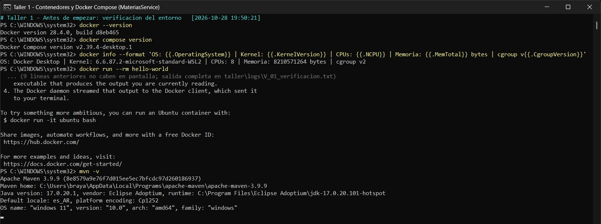
*Figura 1. `docker --version`, `docker compose version`, `docker info` (kernel WSL2, 8 CPU, cgroup v2), `docker run --rm hello-world` y `mvn -v` con Java 17.0.20.1.*

Incidencias resueltas: el primer `hello-world` falló con `open //./pipe/dockerDesktopLinuxEngine` porque Docker Desktop estaba cerrado. Además, `mvn package` hay que ejecutarlo dentro de `MateriasService`, porque desde la carpeta superior no hay `pom.xml`.

---

## Parte A — Un contenedor es un proceso con anteojeras

### A1. El proceso visto desde dos lados

**Predicción:** no se registró antes de ejecutar.

`docker top web` muestra el proceso desde el anfitrión, que aquí es la VM de WSL2 de Docker Desktop:

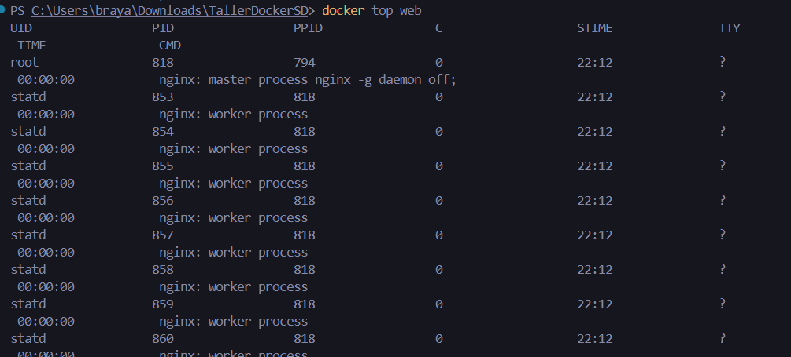
*Figura 2. `docker top web`: el master de nginx tiene PID 818 (su padre, PID 794, es el `containerd-shim`) y hay 8 workers (PIDs 853–860), uno por núcleo.*

Desde adentro, `docker exec web ps aux` falló con `exec: "ps": executable file not found in $PATH`, porque la imagen `nginx` no incluye `procps`. Con `cat /proc/1/cmdline` se vio `nginx: master process nginx -g daemon off;`, y con `ls /proc` aparecieron solo los PIDs 1, 29–36 y 49 (este último es el propio `ls`).

| Proceso | PID fuera (`docker top`) | PID dentro |
|---|---|---|
| nginx master | 818 | **1** |
| 8 workers | 853–860 | 29–36 |

**Respuesta.** `docker top` mira desde el anfitrión y ve los PIDs reales del sistema y al padre `containerd-shim`. Desde adentro, el mismo nginx es el **PID 1** y no existe ningún otro proceso del sistema: son los mismos procesos con dos numeraciones. Lo explica el **PID namespace** del kernel Linux, que le da al contenedor su propio árbol de procesos empezando en 1. El **mount namespace** explica que no exista `ps`: el contenedor solo ve el sistema de archivos de su imagen. Además, los workers aparecen como `statd` en `docker top` porque corren con el UID 101 (`nginx` dentro) y el anfitrión traduce ese UID con su propio `/etc/passwd`; no hay *user namespace* que lo remapee.

### A2. Límites (cgroups)

**Predicción:** no se registró antes de ejecutar.

```
> docker stats --no-stream
NAME       CPU %     MEM USAGE / LIMIT     MEM %    PIDS
limitado   0.00%     7.629MiB / 64MiB      11.92%   9
web        0.00%     7.746MiB / 7.647GiB   0.10%    9
> docker inspect limitado --format '{{.HostConfig.Memory}} {{.HostConfig.NanoCpus}}'
67108864 500000000
```

`limitado` tiene un techo de 64 MiB (64 × 1024 × 1024 = 67 108 864 bytes) y 0,5 CPU (5 × 10⁸ nano-CPU). `web`, sin límite, puede usar toda la memoria de la VM (7,647 GiB). Hay dos detalles importantes:
- El límite **no reserva** memoria: ambos usan unos 7,6 MiB.
- `--cpus=0.5` **no oculta núcleos**: `limitado` sigue teniendo 9 procesos (1 master y 8 workers). Lo que limita es el tiempo de CPU (50 ms de cada 100 ms).

**Respuesta.** Si el proceso intentara usar 200 MB, el cgroup no lo permitiría. Al llegar a 64 MiB, el kernel intenta reclamar memoria y, si no puede, el **OOM killer** mata el proceso con **SIGKILL (9)**. El contenedor termina con **código de salida 137** (128 + 9) y `docker inspect` muestra `OOMKilled: true`. SIGKILL no se puede capturar, así que no hay cierre ordenado. Esto se comprobó en la práctica en D4 (Figura 44).

### A3. Capas y caché de build

**Predicción:** no se registró antes de ejecutar.

`docker pull eclipse-temurin:21-jre` descargó 6 capas. `docker history` mostró 16 filas, de las que solo 6 tienen tamaño mayor que 0; las demás (`ENV`, `ENTRYPOINT`, configuración) son metadatos de 0 B.

| Capa | Tamaño |
|---|---|
| Sistema base Ubuntu | 117 MB |
| Paquetes del sistema (`apt-get`) | 58,2 MB |
| **JRE de Java 21** | **166 MB** |
| Metadatos, verificación y `entrypoint.sh` | 12,3 kB c/u |

`docker image ls` reportó 456 MB.

**Respuesta.** Tiene **6 capas con contenido**, y la más grande es la del **JRE (166 MB)**. Diez contenedores no ocupan 10 veces el tamaño porque las capas de la imagen son de **solo lectura y se comparten**: están en disco una sola vez. Cada contenedor agrega encima solo una capa delgada de escritura (*copy-on-write*).

### A4. Lo efímero: la BD que perdió los datos

**Predicción:** sin volumen, el `SELECT` del segundo `pg1` falla. Con volumen, la fila sobrevive.

**Sin volumen** (27 oct):
```
> docker exec -it pg1 psql -U postgres -c "CREATE TABLE prueba(id int); INSERT INTO prueba VALUES (1);"
CREATE TABLE / INSERT 0 1
> docker rm -f pg1  →  docker run -d --name pg1 ... postgres:16
> docker exec -it pg1 psql -U postgres -c "SELECT * FROM prueba;"
ERROR:  relation "prueba" does not exist
```

Al revisar el segundo `pg1` se ve dónde estaban los datos. La imagen `postgres` declara `VOLUME /var/lib/postgresql/data`, así que Docker le creó un **volumen anónimo** con un nombre aleatorio:

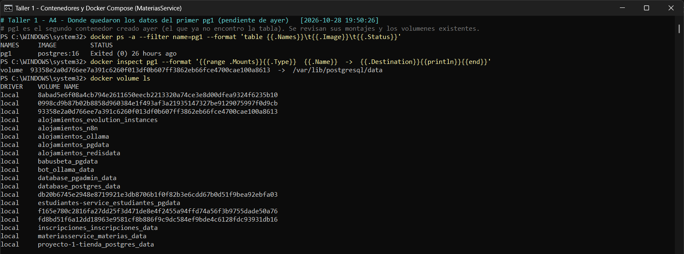
*Figura 3. `docker inspect pg1` muestra un volumen anónimo (`93358e2a…`) montado en `/var/lib/postgresql/data`. En `docker volume ls` hay varios volúmenes con nombre hexadecimal, que quedaron huérfanos de contenedores borrados.*

**Con volumen con nombre** (`pgdata`):

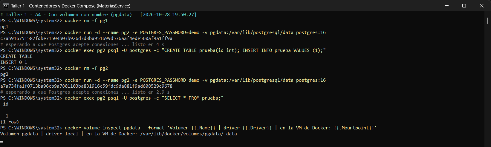
*Figura 4. Se crea la tabla en `pg2`, se borra el contenedor y se crea otro con el **mismo** volumen `pgdata`: el `SELECT` devuelve la fila `id = 1`. El volumen vive en `/var/lib/docker/volumes/pgdata/_data` dentro de la VM de Docker.*

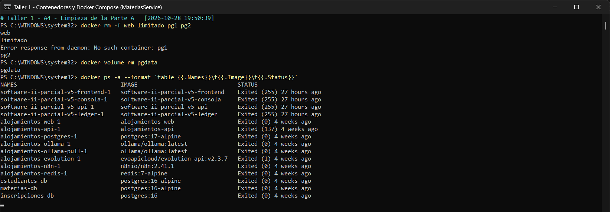
*Figura 5. Limpieza: `docker rm -f web limitado pg1 pg2` y `docker volume rm pgdata`. El error *No such container: pg1* es esperado, porque `pg1` ya se había borrado en el paso anterior.*

**Respuesta.**
- **Primer caso:** los datos estaban en un **volumen anónimo** creado automáticamente. `docker rm -f` lo dejó huérfano y el contenedor nuevo recibió **otro** volumen anónimo vacío. Si la imagen no declarara `VOLUME`, los datos habrían estado en la capa de escritura del contenedor y se habrían borrado con él.
- **Segundo caso:** los datos están en el **volumen con nombre `pgdata`**, que Docker gestiona aparte del ciclo de vida del contenedor.
- **Comando que borra el volumen:** `docker volume rm pgdata`. Para los anónimos huérfanos, `docker volume prune`, o `docker rm -v` al borrar el contenedor.

---

## Parte B — Contenedorizar el módulo Materias

Antes de tocar el proyecto se trabajó en una rama nueva, `taller-contenedores`, creada a partir de `main`:

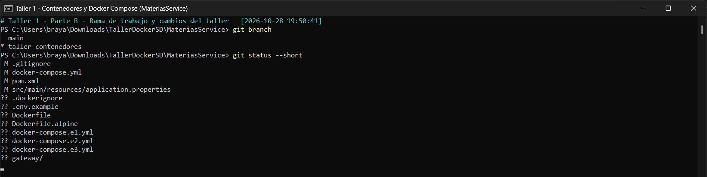
*Figura 6. `git branch` muestra la rama `taller-contenedores` activa. `git status` muestra los archivos del taller: `Dockerfile`, `.dockerignore`, `docker-compose.yml`, `.env.example`, archivos de los retos y los cambios en `pom.xml` y `application.properties`.*

### B1. Endpoint de salud (Actuator)

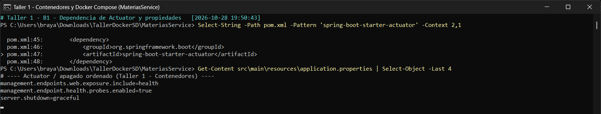
*Figura 7. Dependencia `spring-boot-starter-actuator` en el `pom.xml` y las tres propiedades del taller en `application.properties` (exposición de `health`, sondas habilitadas y `server.shutdown=graceful`).*

Para verificar en local, sin contenedor de la app, se levantó una BD temporal en el puerto 5433, que es el que usa `application.properties`, y se ejecutó el jar con `java -jar`:

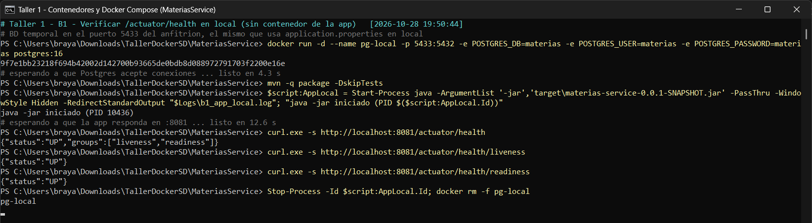
*Figura 8. Tras `mvn -q package`, la app respondió en 12,6 s: `/actuator/health` → `{"status":"UP","groups":["liveness","readiness"]}`, y también `liveness` y `readiness` en `UP`.*

### B2. Dockerfile multi-etapa y `.dockerignore`

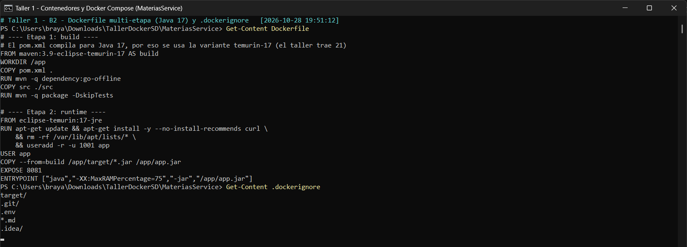
*Figura 9. `Dockerfile` adaptado a Java 17 (`maven:3.9-eclipse-temurin-17` → `eclipse-temurin:17-jre`), con usuario `app` (UID 1001), `ENTRYPOINT` en forma exec y el `.dockerignore` del taller.*

**Pregunta de reflexión: cómo evitar instalar `curl`.**
- Hacer el chequeo sin herramientas extra, con una pequeña clase Java (`java -cp app.jar ...HealthCheck`) o con un binario estático de healthcheck copiado desde otra etapa.
- Usar una base que ya traiga `wget`, como busybox o alpine.
- Delegarlo al orquestador: en Kubernetes, el kubelet hace las sondas *liveness* y *readiness* por HTTP desde fuera del contenedor, y la imagen no necesita ningún cliente HTTP. Eso permite usar imágenes *distroless*.

### B3. Construir y ejecutar

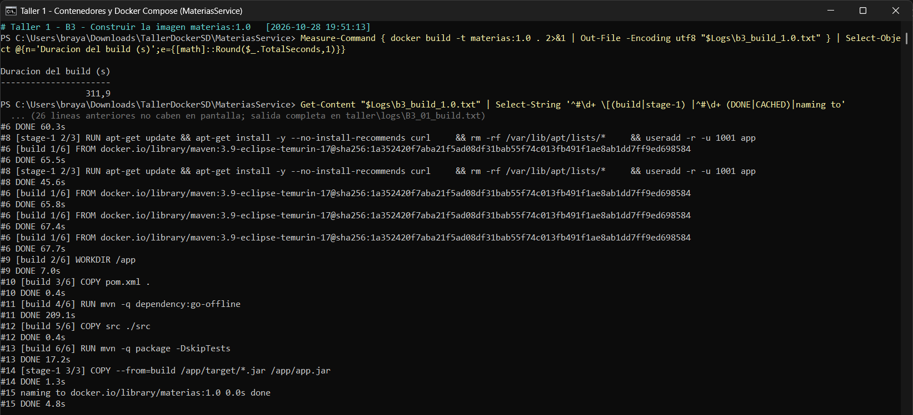
*Figura 10. Primer `docker build -t materias:1.0 .`: **311,9 s** en total. Casi todo fue `RUN mvn -q dependency:go-offline` (209,1 s, la descarga de dependencias); `mvn package` tardó 17,2 s y la copia del jar a la etapa final 1,3 s.*

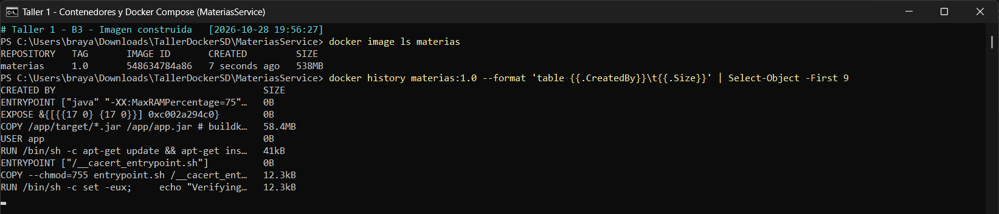
*Figura 11. `docker image ls materias`: la imagen pesa **538 MB**. `docker history` muestra que lo único propio del módulo es la capa del jar (58,4 MB) y la de `curl` y el usuario; el resto viene de `eclipse-temurin:17-jre`.*

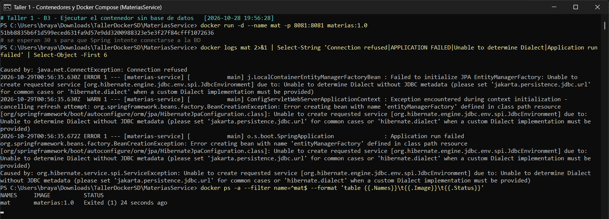
*Figura 12. `docker run -d --name mat -p 8081:8081 materias:1.0` sin base de datos: Hibernate no puede conectarse (`java.net.ConnectException: Connection refused` y `Unable to determine Dialect without JDBC metadata`), Spring aborta (`Application run failed`) y el contenedor queda `Exited (1)`. Era lo esperado.*

### B4. Cuatro verificaciones obligatorias

Como sin BD el módulo muere en segundos, para las verificaciones se le dio una BD temporal (`pg-b4`) en una red de prueba (`red-b4`):

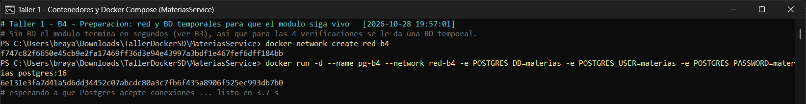
*Figura 13. Red y PostgreSQL temporales para que el contenedor `mat` siga vivo durante las verificaciones.*

**Predicción (forma exec):** `uid=1001(app)`, PID 1 = `java`, `docker stop` en menos de 2 s y código 143.

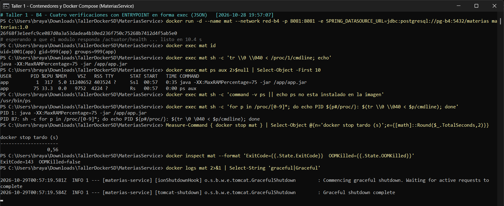
*Figura 14. ENTRYPOINT en forma exec: `uid=1001(app)` (no es root); el PID 1 es `java -XX:MaxRAMPercentage=75 -jar /app/app.jar`; `docker stop` tardó **0,56 s**; **ExitCode=143** (128 + 15, SIGTERM); en los logs aparece *Commencing graceful shutdown… Graceful shutdown complete*.*

**Predicción (forma shell):** PID 1 = `/bin/sh -c java…`, unos 10 s y código 137. Teníamos una duda: si `dash` hacía `exec` del último comando, java podría quedar como PID 1.

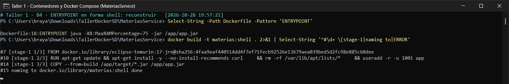
*Figura 15. Se cambia a `ENTRYPOINT java -XX:MaxRAMPercentage=75 -jar /app/app.jar` y se reconstruye como `materias:shell`. Solo se rehacen las capas de la etapa final.*

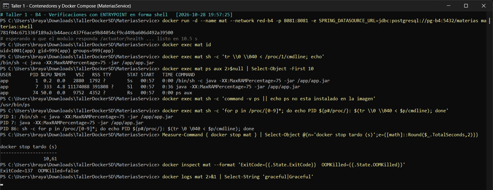
*Figura 16. Con la forma shell, el PID 1 es `/bin/sh -c java …` y java pasa a ser el **PID 7**. `docker stop` tardó **10,61 s**, el código es **137** (SIGKILL) y **no hay** mensajes de *graceful shutdown*.*

Para confirmar que la diferencia la causa el `sh` intermedio, se probó también una forma shell con un comando compuesto, en la que el shell no puede hacer `exec`:

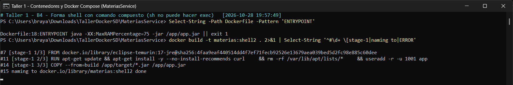
*Figura 17. Variante `ENTRYPOINT java … -jar /app/app.jar || exit 1`.*

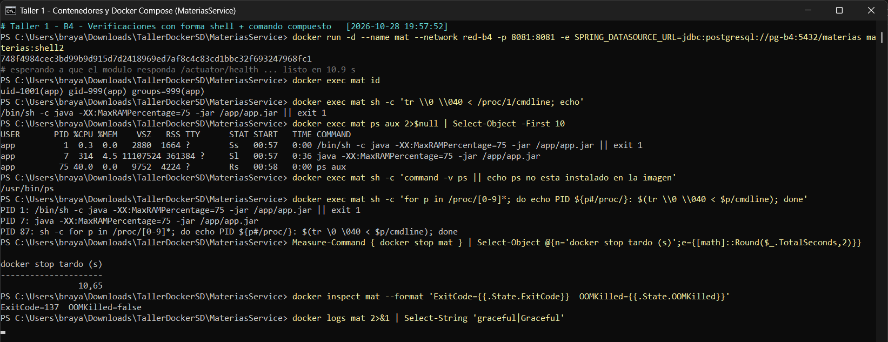
*Figura 18. Mismo resultado que la forma shell simple: PID 1 = `sh`, **10,65 s**, ExitCode **137** y sin cierre ordenado.*

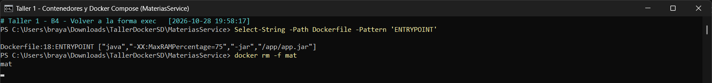
*Figura 19. Se vuelve a la forma exec (lista JSON) en el Dockerfile.*

| ENTRYPOINT | PID 1 | `docker stop` | ExitCode | Cierre ordenado |
|---|---|---|---|---|
| Exec `["java",…]` | java | **0,56 s** | 143 | Sí |
| Shell `java …` | `/bin/sh -c` | **10,61 s** | 137 | No |
| Shell `java … \|\| exit 1` | `/bin/sh -c` | **10,65 s** | 137 | No |

**Respuestas.**
- **¿El PID 1 es java? ¿Por qué importa?** Sí, con la forma exec. Importa porque `docker stop` envía SIGTERM **solo al PID 1**. Si el PID 1 es java, la JVM ejecuta sus *shutdown hooks* y Spring hace el *graceful shutdown*: termina las peticiones en curso y cierra el pool de conexiones. Además, el PID 1 de un namespace no tiene manejadores por defecto, así que solo reacciona a las señales que maneja explícitamente, como hace la JVM.
- **¿`docker stop` tardó cerca de 10 s?** Con la forma exec no (0,56 s). Con la forma shell sí: `sh` es el PID 1, no reenvía SIGTERM a su hijo java y, como PID 1, lo ignora. Docker espera el periodo de gracia de 10 s y luego mata todo con SIGKILL (código 137).
- **Diferencia anotada:** de 0,56 s a 10,61 s, de código 143 a 137, y se pierde el cierre ordenado. Al final se volvió a la forma exec.

### B5. Caché de build

**Predicción:** con el orden correcto, `COPY pom.xml` y `go-offline` salen `CACHED` y el build es rápido. Con `COPY src` antes, `go-offline` se repite en cada cambio.

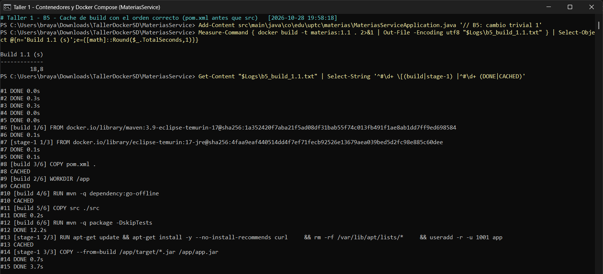
*Figura 20. Cambio trivial en `MateriasServiceApplication.java` y `docker build -t materias:1.1 .`: **18,8 s**. Salen `CACHED` `WORKDIR`, `COPY pom.xml`, `RUN mvn dependency:go-offline` y el `apt-get` de la etapa final. Solo se rehacen `COPY src` (0,2 s), `mvn package` (12,2 s) y la copia del jar.*

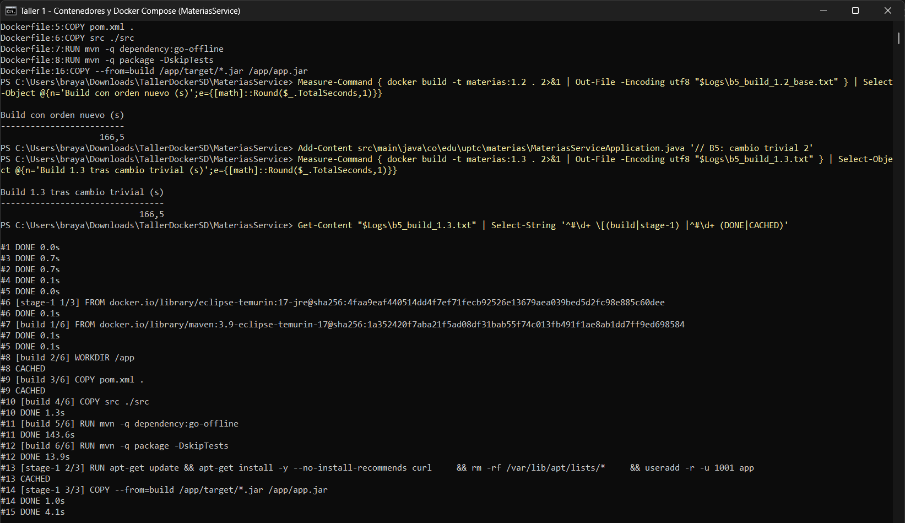
*Figura 21. Con `COPY src ./src` **antes** de `go-offline`, otro cambio trivial cuesta **166,5 s**: `go-offline` **no** sale `CACHED` y vuelve a descargar todas las dependencias (143,6 s).*

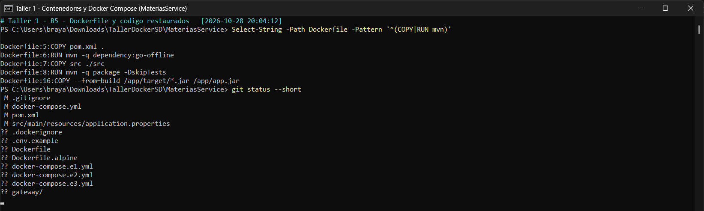
*Figura 22. El Dockerfile vuelve al orden correcto y se revierten los cambios triviales del `.java`.*

**Respuesta.** Cada instrucción es una capa, y su caché se invalida si cambia la instrucción o los archivos que copia. **Todas las capas siguientes también se invalidan.** Como `pom.xml` cambia poco, copiarlo solo y bajar las dependencias en una capa propia permite reutilizarla mientras únicamente cambien los `.java`.

| Build | Tiempo | Capas reutilizadas | Capas rehechas |
|---|---|---|---|
| Primero (`1.0`) | 311,9 s | ninguna | todas (incluye descargar imágenes base) |
| Orden correcto (`1.1`) | **18,8 s** | `WORKDIR`, `COPY pom.xml`, `go-offline`, `apt-get` | `COPY src`, `mvn package`, `COPY --from=build` |
| Orden incorrecto (`1.3`) | **166,5 s** | `WORKDIR`, `COPY pom.xml`, `apt-get` | `COPY src`, **`go-offline`**, `mvn package`, `COPY --from=build` |

---

## Parte C — docker compose: módulo + base de datos

### C0. Archivos `.env`, `.env.example` y `.gitignore`

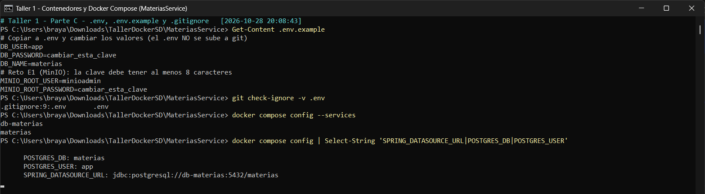
*Figura 23. `.env.example` (sí se sube) con valores de ejemplo. `git check-ignore -v .env` confirma que `.env` lo ignora la línea 9 del `.gitignore`. `docker compose config` resuelve las variables: `POSTGRES_USER: app` y `SPRING_DATASOURCE_URL: jdbc:postgresql://db-materias:5432/materias`.*

Incidencia: en el primer intento no existía `.env` y Compose avisó *The "DB_USER" variable is not set. Defaulting to a blank string*. Con usuario vacío, PostgreSQL no arrancó (`dependency failed to start: container … exited (1)`). Se creó el `.env` y se repitió.

### C1. Levantar y observar

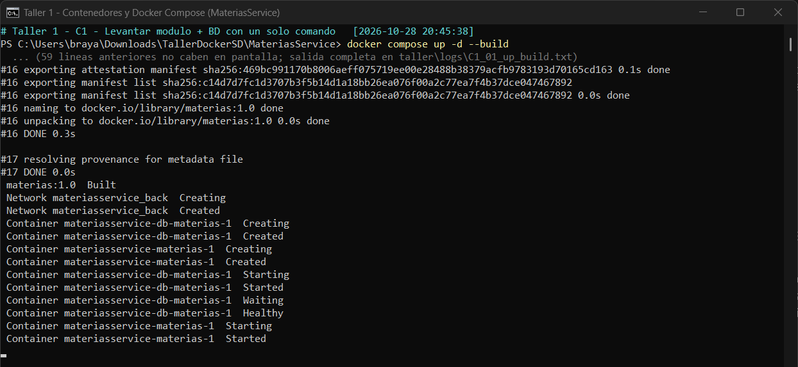
*Figura 24. `docker compose up -d --build`: la imagen sale de la caché, se crea la red privada `materiasservice_back` (el volumen `materiasservice_materias-data` ya existía) y Compose **espera** a que `db-materias` esté `Healthy` antes de arrancar `materias`.*

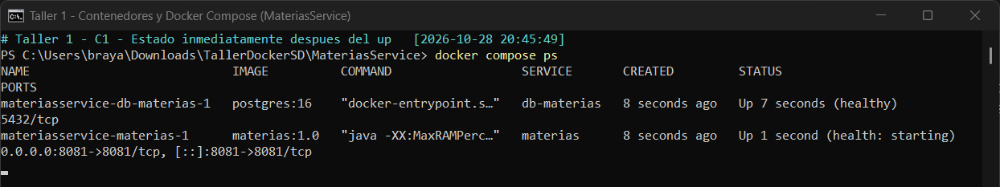
*Figura 25. Inmediatamente después: `db-materias` ya está `(healthy)` y `materias` está en `(health: starting)`. La BD no publica puertos (solo `5432/tcp` interno); el módulo publica `8081`.*

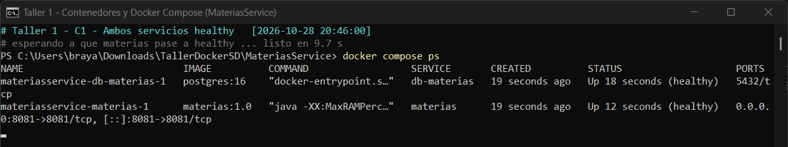
*Figura 26. **Ambos servicios `healthy`**, unos 10 s después.*

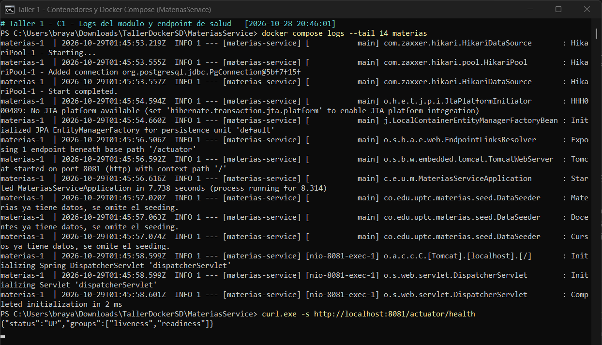
*Figura 27. Logs del módulo: `Started MateriasServiceApplication in 7.738 seconds`. El `DataSeeder` siembra 20 materias, 15 docentes y 30 cursos. `/actuator/health` → `UP`.*

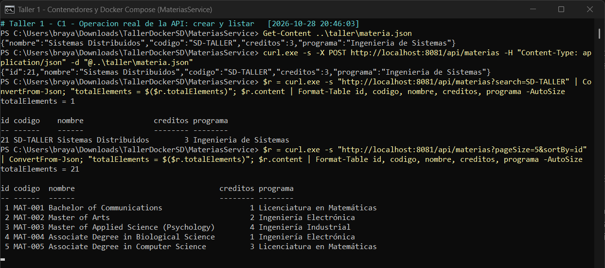
*Figura 28. Operación real de la API: `POST /api/materias` crea *Sistemas Distribuidos* (`SD-TALLER`, id 21); la búsqueda por `SD-TALLER` la encuentra y el listado tiene `totalElements = 21`.*

### C2. Tres experimentos sobre redes

**1. ¿Es la BD accesible desde el portátil?**

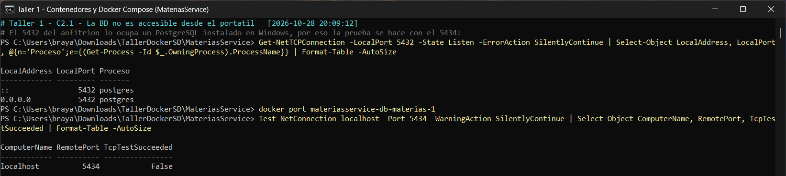
*Figura 29. El 5432 del anfitrión lo usa un `postgres` de Windows. Por eso la prueba se hizo con el 5434. `docker port` no muestra nada para `db-materias` y `Test-NetConnection localhost -Port 5434` da **False**.*

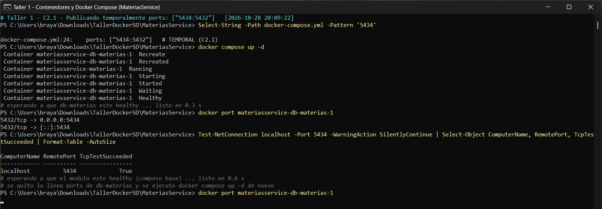
*Figura 30. Con `ports: ["5434:5432"]` temporal, `docker port` muestra `5432/tcp -> 0.0.0.0:5434` y la conexión da **True**. Luego se quitó la línea y `docker port` volvió a estar vacío.*

**Respuesta.** Publicar el puerto de la BD la expone a cualquiera que alcance la máquina: el `0.0.0.0` escucha en **todas** las interfaces, incluida la red Wi-Fi o la del campus. Eso habilita ataques de fuerza bruta a contraseñas, explotación de vulnerabilidades de PostgreSQL o lectura de datos si hay credenciales débiles, como `cambiame123`. La BD solo debe ser accesible para el servicio que la usa, a través de la red privada `back`.

**2. El error de `localhost`**

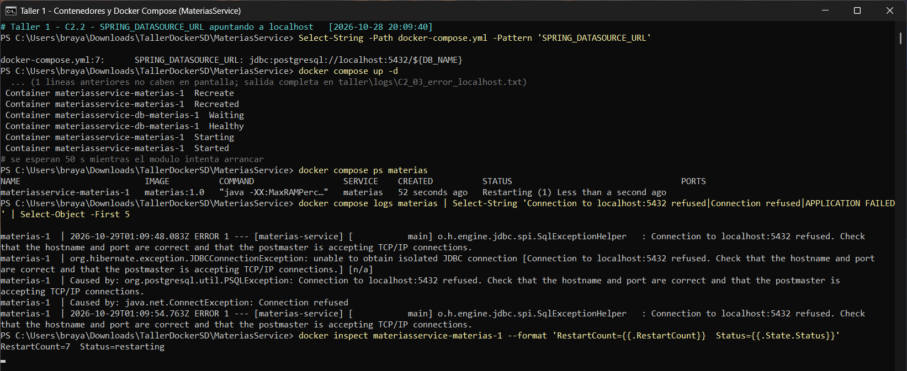
*Figura 31. Con `SPRING_DATASOURCE_URL=jdbc:postgresql://localhost:5432/…`: `Connection to localhost:5432 refused`. El contenedor queda `Restarting (1)` y en 50 s acumuló **RestartCount=7**.*

**Respuesta.** Cada contenedor tiene su **propio namespace de red**: dentro de `materias`, `localhost` es el propio contenedor y ahí no hay PostgreSQL escuchando. Se reemplaza por el **nombre del servicio**, `db-materias`, que resuelve el DNS interno de Docker en la red `back`.

**3. DNS interno**

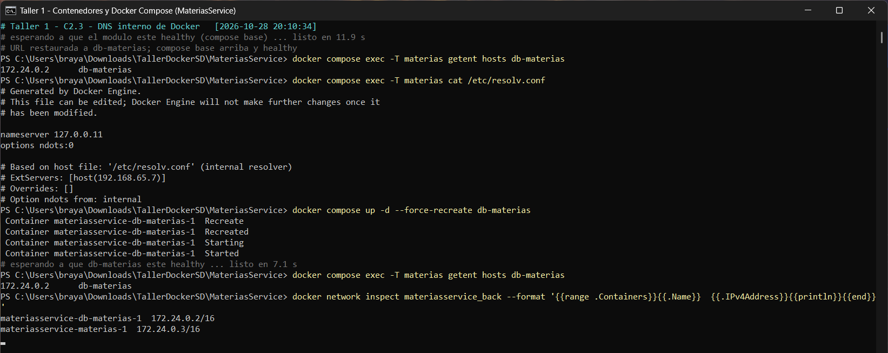
*Figura 32. `getent hosts db-materias` → `172.24.0.2`. El resolvedor es `127.0.0.11`, el DNS embebido de Docker. Tras `--force-recreate db-materias`, la IP fue de nuevo `172.24.0.2` y `materias` es `172.24.0.3`.*

**Respuesta.** Devuelve una IP privada de la red `back` (172.24.0.2). Al recrear el contenedor de la BD, Docker le asigna **una IP nueva del pool**. En esta prueba coincidió con la anterior porque era la primera libre, pero no está garantizado: si otro contenedor la toma o cambia el orden de arranque, cambia. Por eso nunca se configuran IPs, sino el nombre del servicio; el DNS de Docker siempre devuelve la IP actual.

### C3. Persistencia real

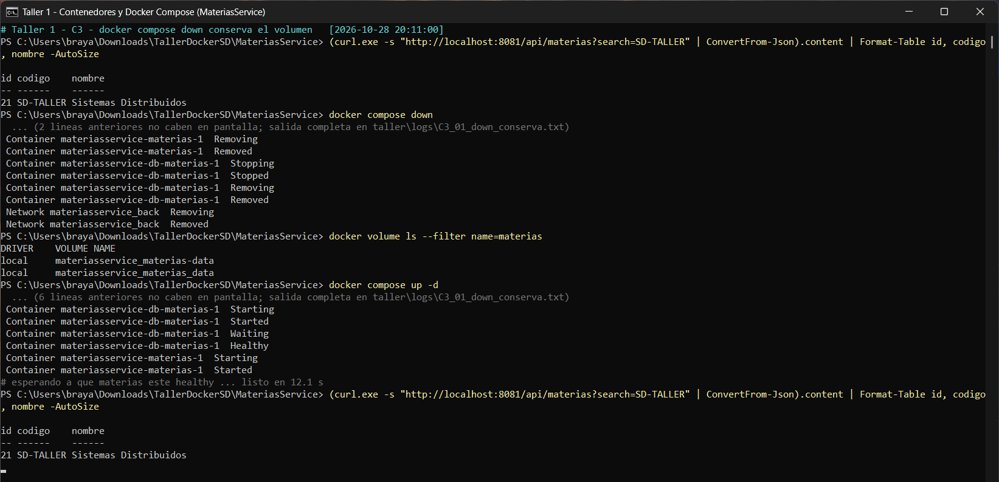
*Figura 33. Con `SD-TALLER` creada, `docker compose down` borra contenedores y red, pero el volumen `materiasservice_materias-data` sigue en `docker volume ls`. Tras `up -d`, la materia (id 21) **sigue existiendo**.*

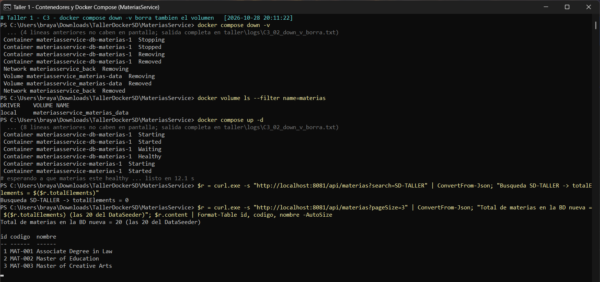
*Figura 34. `docker compose down -v` también elimina el volumen (`Volume … Removed`). Tras `up -d`, la búsqueda de `SD-TALLER` da `totalElements = 0`: la BD es nueva y solo tiene las 20 materias del `DataSeeder`.*

> El volumen `materiasservice_materias_data`, con guion bajo, es del `docker-compose.yml` original del repo y no lo usa este compose.

**Respuesta.**
- **`down`** detiene y borra contenedores y redes, pero **conserva los volúmenes**. Es el uso diario: apagar el entorno, actualizar una imagen o reiniciar sin perder datos.
- **`down -v`** también borra los volúmenes con nombre del proyecto. Se usa para empezar de cero: datos de prueba corruptos, un cambio de esquema en desarrollo, reproducir un error desde una BD limpia o limpiar al terminar un proyecto. **Nunca** se usa sobre datos que importan.

### C4. Orden de arranque

**Predicción:** sin `depends_on`, el módulo intentaría conectarse antes de que Postgres esté listo, fallaría y se reiniciaría.

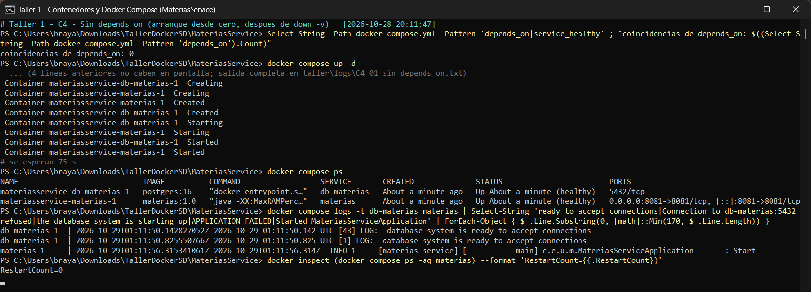
*Figura 35. Sin `depends_on`, desde cero (`down -v`), Compose arranca los dos contenedores **a la vez** (`Starting` seguidos). Esta vez Postgres estuvo listo a las 01:11:50.8 y Spring terminó de arrancar a las 01:11:56.3, así que **no** hubo fallo (`RestartCount=0`).*

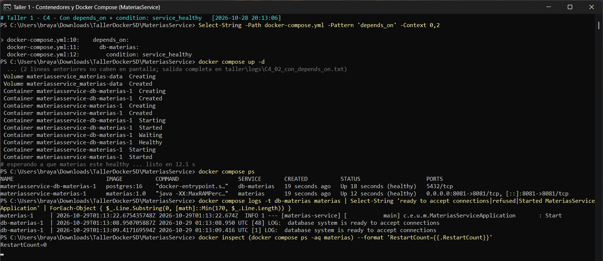
*Figura 36. Con `depends_on` + `condition: service_healthy`, Compose muestra `db-materias Waiting` → `Healthy` y **solo después** `materias Starting`.*

**Respuesta.** En esta máquina la carrera no se perdió. La inicialización de Postgres con una BD vacía tardó unos 2 s, y Spring tarda unos 6 s en llegar al punto en que abre la primera conexión JDBC. **Funcionó por suerte, no por diseño**: con un disco más lento, scripts de inicialización grandes o una BD con mucha recuperación pendiente, el módulo habría fallado al conectarse (*Connection refused* o *the database system is starting up*) y habría dependido de `restart` para reintentar. `depends_on` **sin** condición solo garantiza que el contenedor de la BD se haya **creado y arrancado** (*started*), no que PostgreSQL **acepte conexiones**. Con `condition: service_healthy`, Compose espera a que el healthcheck (`pg_isready`) pase, y el orden queda garantizado.

---

## Parte D — Provocar fallos

### Tabla de predicciones y resultados

| # | Acción | Predicción (antes) | Observado | ¿Acertamos? |
|---|---|---|---|---|
| D1 | `stop db-materias` y llamar a la API | El módulo no se cae; 500 tras ~30 s; health 503; luego `unhealthy` | API **500 en 30,09 s**; health **503 DOWN en 30,02 s**; contenedor `running` pero `unhealthy` (FailingStreak 5, RestartCount 0) | Sí |
| D2 | `start db-materias` | Se recupera solo en pocos segundos | API **200 a los 6,1 s**, sin reinicio (mismo `StartedAt`, RestartCount 0) | Sí |
| D3 | `docker kill` con `restart: unless-stopped` | Se reinicia; RestartCount = 1 | **No se reinició**: `exited`, RestartCount 0. Con una **caída real** (SIGKILL desde el anfitrión) sí: RestartCount 1, `healthy` en 7,4 s | **No** (ver explicación) |
| D4 | `mem_limit: 128m` | No arranca: OOMKilled, 137, bucle | **Sí arrancó** (Spring en 19,3 s, usando 125,9 MiB de 128). Desde **112m** hacia abajo: muerto por OOM (137) en bucle | **No** |
| D5 | Sin `restart` y repetir D3 | Queda `Exited (137)` y no vuelve | `Exited (137)`, RestartPolicy `no`, RestartCount 0 (con `docker kill` y con caída real) | Sí |

### D1. Se cae la base de datos

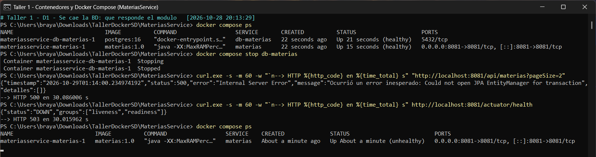
*Figura 37. Con `db-materias` detenida, `GET /api/materias` responde **HTTP 500 en 30,09 s** (*Could not open JPA EntityManager for transaction*) y `/actuator/health` responde **503 `{"status":"DOWN"}` en 30,02 s**. `docker compose ps` ya muestra `materias` como `(unhealthy)`.*

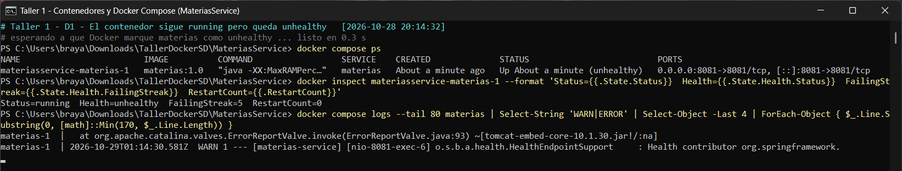
*Figura 38. `docker inspect`: `Status=running`, `Health=unhealthy`, `FailingStreak=5`, `RestartCount=0`. El proceso sigue vivo, pero no sirve.*

Los 30 s corresponden al `connectionTimeout` por defecto de HikariCP: cada petición espera 30 s una conexión antes de fallar.

### D2. Vuelve la base de datos

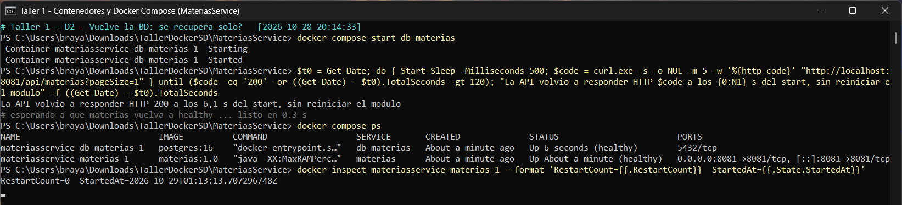
*Figura 39. Tras `docker compose start db-materias`, la API vuelve a responder **200 a los 6,1 s**, el contenedor pasa a `healthy` y `RestartCount=0` con el mismo `StartedAt`: **se recuperó sin reiniciarse**.*

**Respuesta D1/D2.** Sí, el módulo se recupera sin reiniciarlo: HikariCP descarta las conexiones rotas y abre conexiones nuevas cuando se las piden. Mientras la BD estuvo caída, cada petición quedó **colgada 30 s** y luego falló, lo que consume hilos de Tomcat y degrada todo el servicio. Se puede mejorar con:
- **Timeouts** cortos (`spring.datasource.hikari.connection-timeout=2000`), para fallar rápido.
- **Reintentos** con espera exponencial solo para operaciones idempotentes.
- Un **circuit breaker** (Resilience4j): tras varios fallos abre el circuito y responde de inmediato con un 503 controlado, sin tocar la BD, hasta que una prueba en estado *half-open* confirme que volvió.
- Un healthcheck de *readiness* separado del de *liveness*, para que un orquestador saque el pod del balanceo sin matarlo.

### D3. Matar el contenedor

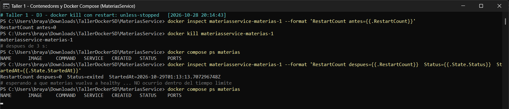
*Figura 40. `docker kill materiasservice-materias-1` con `restart: unless-stopped`: el contenedor queda `exited`, **RestartCount=0** y no volvió en 180 s.*

**Equivocación y explicación.** Esperábamos que se reiniciara. En Docker Engine 28, `docker kill` cuenta como una **parada manual** del usuario, igual que `docker stop`, y con una parada manual Docker **no aplica la política de reinicio** hasta que el contenedor se arranque a mano o se reinicie el daemon. `unless-stopped` significa justamente eso: reiniciar salvo que alguien lo haya detenido.

Para ver la política funcionando ante un **crash real**, se mató el proceso java desde el espacio de PIDs del anfitrión, la VM de Docker Desktop, con un contenedor auxiliar (`--pid=host`). Para Docker eso es una muerte inesperada del proceso, no una orden del usuario:

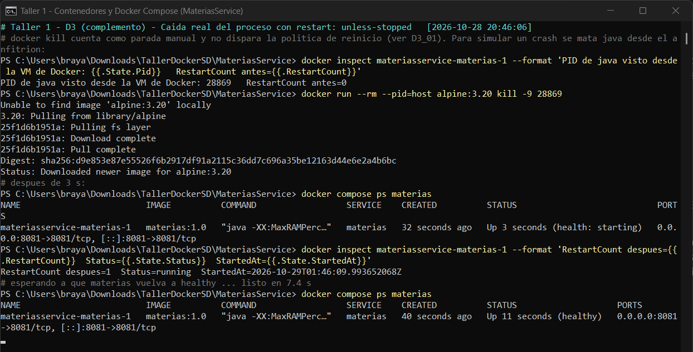
*Figura 41. `kill -9` al PID 28869 (java visto desde la VM): a los 3 s el contenedor ya está `Up 3 seconds (health: starting)`, **RestartCount=1**, y vuelve a `healthy` en 7,4 s.*

### D4. Poca memoria

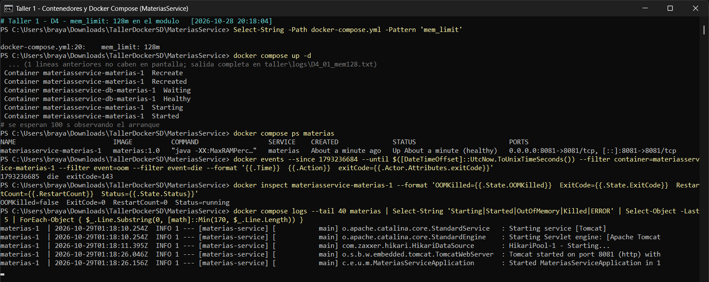
*Figura 42. `mem_limit: 128m`: el módulo **arranca**, aunque lento. Spring tardó unos 19 s frente a los ~8 s normales. No hubo eventos `oom` y `OOMKilled=false`. El evento `die exitCode=143` es el del contenedor anterior, detenido con SIGTERM al recrearlo.*

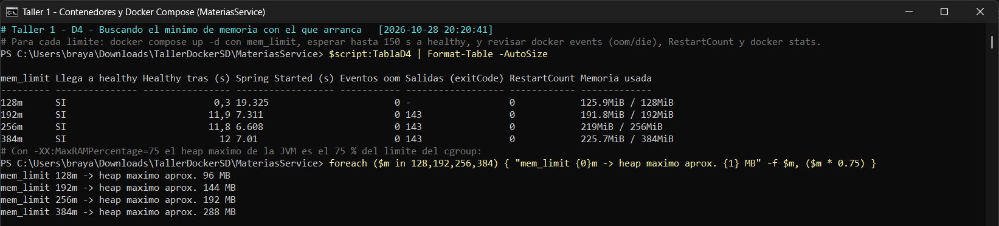
*Figura 43. Prueba con 128m, 192m, 256m y 384m: todos llegan a `healthy`. Con 128m usa **125,9 MiB de 128** y Spring arranca en 19,3 s; desde 192m arranca en ~7 s. El heap máximo es el 75 % del límite (96 MB con 128m).*

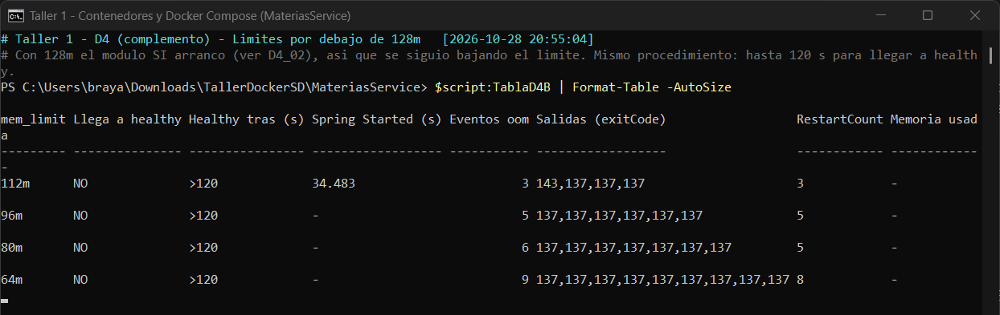
*Figura 44. Por debajo de 128m **no arranca**. Con **112m** Spring alcanzó a arrancar (34,5 s), pero el kernel lo mató por OOM 3 veces (`die` con 137). Con **96m, 80m y 64m** nunca termina de arrancar: 5, 6 y 9 eventos `oom` y reinicios en bucle.*

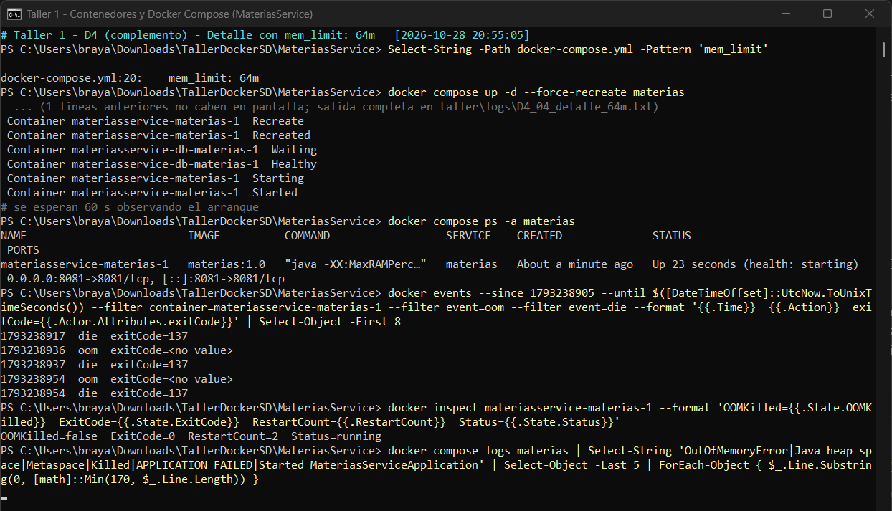
*Figura 45. Detalle con 64m: `docker events` muestra la secuencia `oom` → `die exitCode=137` cada ~18 s; `RestartCount=2` en un minuto. `docker inspect` dice `OOMKilled=false, Status=running` porque se tomó justo cuando el contenedor había sido **reiniciado** y el estado se reinicia en cada arranque. La evidencia del OOM está en los eventos. No hay `OutOfMemoryError` en los logs: no es Java el que se queda sin heap, es el kernel el que mata el proceso.*

**Respuesta.** El valor mínimo con el que el módulo arranca de forma estable es **128 MiB**: con 112 MiB ya lo mata el OOM killer, y 128 MiB funciona pero al límite y lento. La relación con `-XX:MaxRAMPercentage=75` es que la JVM lee el límite del cgroup y fija el heap máximo en el 75 %: 96 MB con 128m y 84 MB con 112m. El 25 % restante debe alcanzar para todo lo que **no** es heap: *metaspace* (Spring, Hibernate y springdoc cargan muchas clases), *code cache* del JIT, pilas de hilos y buffers. Si el porcentaje es demasiado alto, heap + no-heap superan el límite y el **kernel** mata el proceso con 137, como pasó aquí. Si es demasiado bajo, la JVM lanza `OutOfMemoryError: Java heap space` aunque al contenedor le sobre memoria. Para producción convendría dar al menos 256–384 MiB: con 384m el módulo usa unos 226 MiB y arranca en 7 s.

### D5. Sin política de reinicio

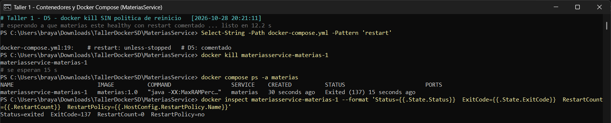
*Figura 46. Con `restart` comentado: `docker kill` deja el contenedor en `Exited (137)`, `RestartPolicy=no`, RestartCount 0.*

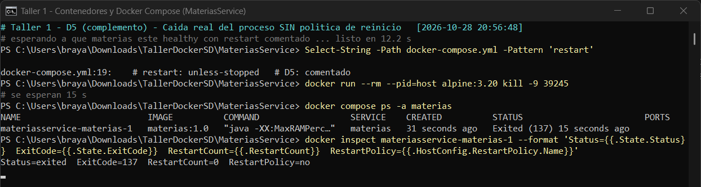
*Figura 47. La misma caída real de D3 (SIGKILL desde el anfitrión), ahora sin política: queda en **`Exited (137)`** y no vuelve.*

**Diferencia con D3.** Con `docker kill` el resultado es igual en D3 y D5, porque al ser una parada manual la política no aplica. La diferencia aparece ante una **caída real** del proceso: con `restart: unless-stopped`, Docker lo reinició en menos de 3 s (Figura 41); sin política, el servicio queda caído hasta que alguien lo levante a mano (Figura 47).

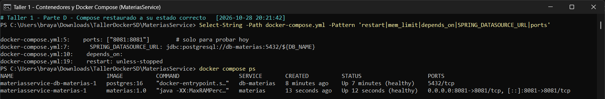
*Figura 48. El compose se restauró a su estado correcto: `restart: unless-stopped`, sin `mem_limit`, con `depends_on` y la URL apuntando a `db-materias`. Ambos servicios están `healthy`.*

### Running vs. healthy

**Respuesta.**
- **running** significa que el proceso principal del contenedor existe y no ha terminado.
- **healthy** significa que, además, el **healthcheck** definido (aquí `curl -fs http://localhost:8081/actuator/health`) viene respondiendo bien, es decir, que la aplicación **sirve de verdad**.

En D1 el contenedor estuvo **running pero unhealthy** (Figura 38): el proceso vivo no garantiza que el servicio funcione. Por eso `depends_on` usa `service_healthy` y no `service_started`.

---

## Parte E — Retos avanzados

| Reto | Estado | Evidencia |
|---|---|---|
| **E1** Redis + MinIO | ✅ Logrado | Figura 54 |
| **E2** Redes `front` / `back` con gateway | ✅ Logrado | Figura 53 |
| **E3** Menor privilegio | ✅ Logrado | Figuras 49–50 |
| **E4** Escaneo de vulnerabilidades | ✅ Logrado (Trivy) | Figuras 51–52 |
| **E5** Tamaño (alpine) | ✅ Logrado | Figuras 55–56 |

### E3 — Menor privilegio (`docker-compose.e3.yml`)

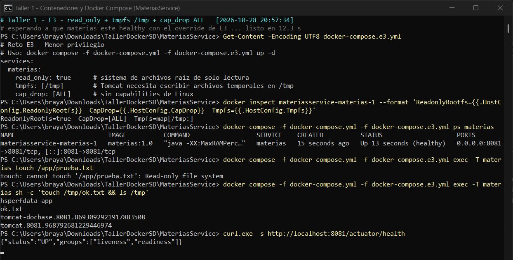
*Figura 49. Con `read_only: true`, `tmpfs: [/tmp]` y `cap_drop: [ALL]`, el módulo sigue **healthy**. `touch /app/prueba.txt` falla con *Read-only file system* y `/tmp` sí es escribible (ahí están `hsperfdata_app` y los directorios de Tomcat).*

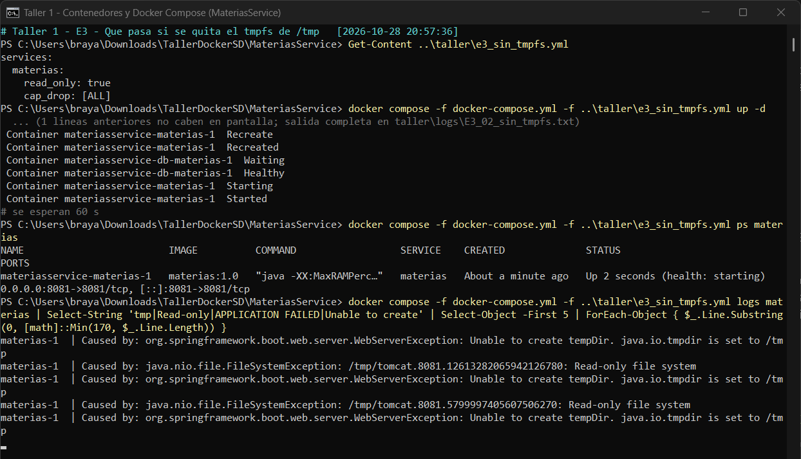
*Figura 50. Sin el `tmpfs`, la app **no arranca**: `Unable to create tempDir. java.io.tmpdir is set to /tmp` → `/tmp/tomcat.8081…: Read-only file system`, y queda reiniciándose.*

**Por qué falla sin tmpfs:** Tomcat embebido necesita crear un directorio de trabajo en `java.io.tmpdir` (`/tmp`). Con la raíz en solo lectura, eso solo es posible si `/tmp` es un `tmpfs` en memoria. `cap_drop: [ALL]` no afecta, porque la app corre como usuario normal, escucha en un puerto > 1024 y no necesita ninguna *capability*.

### E4 — Higiene de imagen (Trivy)


*Figura 51. `aquasec/trivy image --severity HIGH,CRITICAL materias:1.0`: el sistema base (Ubuntu 26.04) tiene **0** vulnerabilidades altas o críticas; el **app.jar** tiene **42 (34 HIGH, 8 CRITICAL)**.*


*Figura 52. `materias:alpine`: la base Alpine 3.24.3 tiene **1 CRITICAL** (`brotli-libs`, con versión corregida disponible) y el jar tiene las mismas **42**.*

Las vulnerabilidades vienen de las **dependencias Java** empaquetadas por Spring Boot 3.3.4: `tomcat-embed-core` 10.1.30 (la mayoría, incluida la crítica CVE-2025-24813), `spring-webmvc`, `spring-core` 6.1.13, `spring-boot` 3.3.4, `jackson`, `micrometer` y el driver `postgresql` 42.7.4.

**Acción de reducción propuesta:** subir el `parent` de Spring Boot a la última versión de parche de 3.x, que trae Tomcat, Spring y Jackson corregidos, y reconstruir. Además, conviene automatizar el escaneo en CI y fallar si hay `CRITICAL`. Para la base alpine, reconstruir con la base actualizada o agregar `apk upgrade --no-cache`.

> El primer intento de escanear `materias:1.0` falló con `context deadline exceeded`: el tiempo por defecto de 5 min no alcanzó, porque también se descargaba la base de datos de vulnerabilidades. Se repitió con `--timeout 20m` y con un volumen de caché (`trivy-cache`). Montar `docker.sock` es una herramienta de laboratorio en nuestra máquina, no un patrón de producción.

### E2 — Dos redes (`docker-compose.e2.yml` + `gateway/nginx.conf`)

El override (`docker-compose.e2.yml`) quita los puertos del módulo con `ports: !reset []` y lo deja solo en la red `back`. Agrega un `nginx` como gateway conectado a `front` y `back`, que es lo único publicado (`8080:80`) y reenvía todo a `http://materias:8081` (`gateway/nginx.conf`).


*Figura 53. Con el override de E2, Compose crea las redes `front` y `back` y arranca el gateway solo cuando `materias` está `Healthy`. Solo el gateway publica puerto (`0.0.0.0:8080->80/tcp`), mientras `materias` muestra `8081/tcp` sin publicar. `localhost:8080/api/materias` → **HTTP 200** a través del gateway; `localhost:8081` → `curl` código 7 (no se pudo conectar). El gateway está en `back` y `front`; `materias`, solo en `back`. La red `materiasservice_default` es un resto del compose original del repo.*

### E1 — Más piezas: Redis y MinIO (`docker-compose.e1.yml`)


*Figura 54. `redis` (healthcheck `redis-cli ping` → `PONG`) y `minio` (`server /data --console-address ":9001"`, credenciales `MINIO_ROOT_USER`/`MINIO_ROOT_PASSWORD` desde `.env`, volumen `minio-data`), todos `healthy`. La API S3 `:9000/minio/health/live` → 200 y la consola `:9001` → 200.*

> **Incidencia:** `minio/minio` dio `pull access denied`. MinIO borró sus imágenes de Docker Hub el 11-sep-2026 y Quay exige autenticación desde el 24-sep-2026. Se usó `pgsty/silo:RELEASE.2026-09-16T00-00-00Z`, un fork comunitario compatible con MinIO, con los mismos parámetros. El healthcheck prueba `mcli`/`mc ready local` o `curl`/`wget` al endpoint `/minio/health/live`, para no depender de qué herramientas traiga la imagen.

### E5 — Tamaño (`Dockerfile.alpine`)


*Figura 55. Variante con `eclipse-temurin:17-jre-alpine`: `apk add --no-cache curl && adduser -D -u 1001 app` en lugar de `apt-get`/`useradd`. El build tardó 29 s gracias a la caché de la etapa de Maven.*


*Figura 56. Comparación con el mismo compose: la imagen alpine pesa **370 MB** frente a **538 MB** (−31 %); el arranque es prácticamente igual (8,45 s frente a 8,28 s) y usa algo menos de memoria.*

| Imagen | Base runtime | Tamaño | Spring *Started* | Memoria en uso | Problemas encontrados |
|---|---|---|---|---|---|
| `materias:1.0` | `eclipse-temurin:17-jre` (Ubuntu 26.04.1) | 538 MB | 8,28 s | 377 MiB | ninguno |
| `materias:alpine` | `eclipse-temurin:17-jre-alpine` (Alpine 3.24.3) | **370 MB** | 8,45 s | 335 MiB | cambiar `apt-get` por `apk` y `useradd` por `adduser -D`; usa musl libc, sin problemas para este jar; 1 CVE crítica propia de la base |

El jar (58 MB) y sus 42 vulnerabilidades son iguales en ambas imágenes: la mayor ganancia de tamaño y seguridad vendría de actualizar dependencias y, a futuro, de un runtime *jlink* o *distroless*.

---

## Evidencia final


*Figura 57. Estado final del `docker-compose.yml` del taller: `materiasservice-db-materias-1` y `materiasservice-materias-1` **(healthy)**.*


*Figura 58. `docker image ls` al final del taller. La lista completa no cabe en la ventana, así que se ve la parte final, con las imágenes base usadas en el taller (`eclipse-temurin:17-jre-alpine`, `postgres:16`, `redis:7-alpine`, `pgsty/silo`, `nginx:1.27-alpine`, `aquasec/trivy`, `alpine:3.20`, `hello-world`) junto a imágenes de otros proyectos de este computador. Las imágenes del módulo están en la parte superior de la lista: `materias:1.0`, `1.1`–`1.3` (B5), `shell`/`shell2` (B4) y `alpine` (E5). Se ven en las Figuras 11 y 55.*


*Figura 59. La rama `taller-contenedores` quedó publicada en GitHub (`git ls-remote` → `refs/heads/taller-contenedores`, commit `1ba42b2`) y sigue a `origin/taller-contenedores`.*

**Archivos entregados en la rama:** `Dockerfile`, `.dockerignore`, `docker-compose.yml`, `.env.example` (el `.env` no se sube), `INFORME.md`, `capturas/` y, de los retos, `docker-compose.e1.yml`, `docker-compose.e2.yml`, `docker-compose.e3.yml`, `gateway/nginx.conf` y `Dockerfile.alpine`.

---

## Equivocaciones (predicción ≠ resultado)

1. **D3:** predijimos que `docker kill` dispararía el reinicio. No lo hizo, porque `docker kill` cuenta como parada manual. La política solo actuó ante una caída real (Figura 41).
2. **D4:** predijimos que con 128m no arrancaría. Sí arrancó; el mínimo real está entre 112m y 128m.
3. **C4:** esperábamos ver fallos de conexión sin `depends_on`. No los hubo, porque Postgres inició antes de que Spring pidiera la conexión. Es una carrera que esta vez ganamos, pero sigue siendo un riesgo.
4. **C2.3:** dijimos que la IP *podría* cambiar al recrear la BD. En esta prueba se repitió (172.24.0.2), porque era la primera libre del pool.
5. **B4 (duda):** pensamos que `dash` podría hacer `exec` y dejar java como PID 1 en la forma shell. No lo hizo: `/bin/sh` quedó como PID 1.
6. **C0:** olvidamos crear el `.env` en el primer intento. Compose usó variables vacías y PostgreSQL no arrancó.

---

## Preguntas de comprensión (individuales)

> Estas preguntas se responden de forma individual. Cada integrante debe revisar y ajustar estas respuestas con sus propias palabras.

1. **¿Qué dos mecanismos del kernel hacen que un proceso sea "un contenedor"? ¿Cuál limita lo que ve y cuál lo que usa?** Los **namespaces** limitan lo que **ve**: PID, red, montajes, hostname, IPC y usuarios (A1: nginx es PID 1 adentro y 818 afuera). Los **cgroups** limitan lo que **usa**: memoria, CPU y número de procesos (A2: 64 MiB y 0,5 CPU; D4: OOM al superar el límite).
2. **¿Por qué un contenedor arranca más rápido que una VM?** Porque no arranca un sistema operativo: no hay BIOS, ni kernel que bootear, ni hardware virtual. Es un proceso más sobre el kernel del anfitrión, que ya está corriendo; crear los namespaces y cgroups toma milisegundos. Aquí PostgreSQL estuvo listo en unos 3–4 s, y casi todo ese tiempo es de Postgres, no de Docker.
3. **Si cinco contenedores usan la misma imagen, ¿cuántas veces se guarda la base en disco?** **Una sola vez.** Las capas de la imagen son de solo lectura y se comparten; cada contenedor solo agrega su propia capa de escritura (*copy-on-write*) (A3).
4. **¿Por qué se copia `pom.xml` antes que `src`?** Por la caché de capas: las dependencias se descargan en una capa que solo depende del `pom.xml`, así que un cambio en el código no las invalida. En B5 fue 18,8 s frente a 166,5 s.
5. **¿Qué resuelve el build multi-etapa?** Separa compilar de ejecutar: Maven, el JDK y el código fuente quedan en la etapa `build`, y la imagen final lleva solo el JRE y el jar. Sin multi-etapa, la imagen sería mucho más grande, incluiría herramientas de compilación y fuentes (más superficie de ataque y más vulnerabilidades) y tardaría más en distribuirse.
6. **Su módulo tarda 10 s en detenerse. Dos posibles causas.** (a) `ENTRYPOINT` en **forma shell**: `sh` es el PID 1 y no reenvía SIGTERM, así que Docker espera 10 s y manda SIGKILL (B4: 10,61 s y 137). (b) La aplicación **ignora SIGTERM** o tarda en cerrar, por peticiones largas, conexiones colgadas o *shutdown hooks* lentos, hasta que vence el periodo de gracia.
7. **¿Por qué `localhost` no funciona para llegar a la BD dentro de Compose?** Cada contenedor tiene su propio namespace de red, y `localhost` es él mismo; la BD está en **otro** contenedor. Hay que usar el nombre del servicio (`db-materias`), que resuelve el DNS interno de Docker (C2.2 y C2.3).
8. **¿Qué diferencia hay entre `depends_on` simple y con `service_healthy`?** El simple solo espera a que el contenedor de la dependencia **haya arrancado**. Con `service_healthy`, Compose espera a que su **healthcheck pase**, es decir, a que PostgreSQL acepte conexiones (`pg_isready`) (C4).
9. **¿Qué pasa con los datos al ejecutar `docker compose down`? ¿Y con `down -v`?** Con `down` **se conservan**: se borran contenedores y redes, pero no los volúmenes. Con `down -v` **se pierden**, porque también se borran los volúmenes del proyecto (C3).
10. **Dos razones para no ejecutar la BD de producción en un contenedor.**
    - (a) **Persistencia y rendimiento de E/S delicados:** los datos dependen de volúmenes y del almacenamiento del nodo. Un `down -v`, un volumen mal montado o un cambio de nodo puede perderlos, y el rendimiento de disco a través de capas de virtualización (como WSL2) es menor.
    - (b) **Operación compleja:** alta disponibilidad, réplicas, respaldos y restauración, actualizaciones de versión y ajuste de memoria. Bajo límites de cgroup, el OOM killer puede matar la BD (como en D4).

    En la práctica se prefiere un servicio gestionado (Cloud SQL, RDS) o servidores dedicados, o al menos un operador especializado en Kubernetes.
